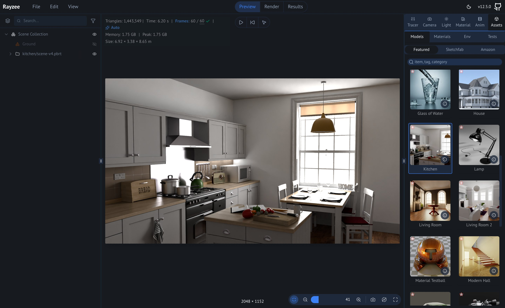
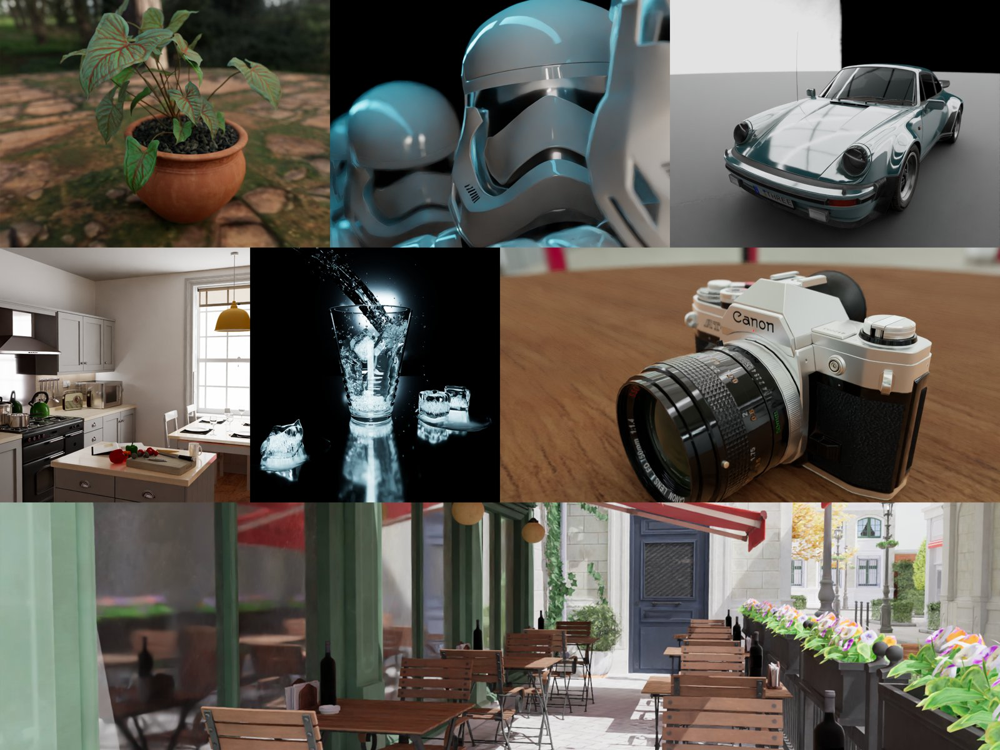

<div align="center">

# Rayzee

**Photoreal rendering in the browser, in real time.**<br>
Drop in a 3D model and watch light bounce around it. Nothing to install.

[![NPM Package][npm]][npm-url]
[![Build Size][build-size]][build-size-url]
[![NPM Downloads][npm-downloads]][npmtrends-url]
[![jsDelivr Downloads][jsdelivr-downloads]][jsdelivr-url]

**[Open the app](https://atul-mourya.github.io/rayzee-renderer/)** · **[Use the engine](#use-the-engine)** · **[Docs](docs/guide)**



<sub>A kitchen from the app's library: 1.4 million triangles, 2048 × 1152, 60 samples in 6 seconds on an Apple M5 Pro.<br>
“Country Kitchen” by Jay-Artist (CC BY 3.0), from Benedikt Bitterli's <a href="https://benedikt-bitterli.me/resources/">Rendering Resources</a>.</sub>

</div>

## What it does

<table>
<tr>
<td width="50%" valign="top"><b>💡 Real light, live</b><br>Every bounce of light is traced on your graphics card. Intel's denoiser cleans the picture while you move.</td>
<td width="50%" valign="top"><b>📂 Opens what you have</b><br>glTF, USD, FBX, OBJ, pbrt-v4 and more, or a whole ZIP or folder.</td>
</tr>
<tr>
<td valign="top"><b>🏝️ Huge scenes</b><br>Disney's Moana island, 111 million triangles, loads in one browser tab.</td>
<td valign="top"><b>🎨 Film colour</b><br>OpenColorIO with Blender's AgX look, ACES, or your studio's own setup.</td>
</tr>
<tr>
<td valign="top"><b>☀️ Physical sky</b><br>A real atmosphere and sun, placed by time of day, month and latitude.</td>
<td valign="top"><b>🧩 An engine to build on</b><br><code>npm install rayzee</code>. Runs in a web page, or with no screen in Node.</td>
</tr>
</table>



<details>
<summary><b>Full feature list</b></summary>

**Rendering**
- **Path tracing on the GPU**: WebGPU compute shaders written in three.js's shading language. As many light bounces as
  you set, and the image keeps sharpening while the view is still
- **Fast scene loading**: the search tree rays use to find surfaces is built in background threads, so loading never
  freezes the page, and updated in place when objects move or animate
- **Repeated objects stored once**: a room of identical chairs costs one chair, so tens of millions of placed plants fit
- **Bidirectional path tracing and vertex merging** (opt-in): light is also traced out from every source (glowing
  surfaces, lights, the sun, the sky) for caustics, light through small openings, and caustics seen in mirrors and
  through glass
- **HDR environment lighting**, sampled where it is brightest so noise clears quickly
- **Physical sky**: a spectral atmosphere (air, haze, ozone, light scattered many times over, the ground's bounce) and a
  sun drawn and sampled as a light of its own, placed by time of day, month and latitude. It rebuilds fast enough to
  follow the Time of Day slider as you drag it
- **Shading that matches Blender**: exact Fresnel on glass, paint and plastic; sharp highlights at their true peak; no
  light leaking out of small cracks; Cycles' fix for dark edges on low-poly curved surfaces. A glossy black sphere
  matches Cycles within 1 % at every angle

**Editing**
- **Live editing**: change a material, the camera, depth of field or the sky and see it at once, with no re-render
- **Full PBR materials**, including clear coat, sheen, iridescence, anisotropy, glass with dispersion, subsurface
  scattering and displacement

**Denoising and picture**
- **Intel Open Image Denoise** cleans both the live view and the finished image. It runs on the renderer's own graphics
  card, and while you move it reuses recent frames, so the picture shimmers about half as much
- **NVIDIA NRD** (a port of its ReBLUR denoiser) for very large live views
- **AI upscaling** (Real-ESRGAN): a finished render is denoised, then enlarged 2× or 4×, instead of traced at full size
- **OpenColorIO**: opens in Blender 5.1's own config (AgX, Medium High Contrast) with its views, looks and displays; or
  load ACES, or a studio's own config folder. Render in ACEScg or another working space, set a colour space per texture,
  and save EXR in a delivery space. The default look ships ready-built, so the first frame waits for no download
- **Exposure in stops**, auto exposure that follows the room rather than each view, and Balance Highlights (Unreal
  Engine 5's local exposure) to keep bright windows from washing out

**Camera**
- **Depth of field** with photographic controls (focal length, aperture, focus distance) and click-to-focus
- **Orthographic views** for elevations, plans and isometrics, with the view's height set in metres or by scrolling.
  Denoisers, depth of field and auto-focus all work in it, and orthographic cameras in glTF and pbrt files import as such
- **360° panoramas**, with longitude and latitude cropping and a level-horizon option
- **Fast Navigation**: lower resolution while the camera moves, full quality the moment it stops
- **Walk mode** for interiors and large scenes: drag to look, walk at eye height with the keyboard at a speed in metres
  per second. Switching back to orbit circles whatever you were looking at
- **Camera keyframes**: key views at chosen times and the camera glides through them, keeping what they look at in frame.
  Preview the move in the viewport, then render it to video, on its own or with the model's own animation

**Scenes and files**
- **Formats**: GLB, glTF, FBX, OBJ, STL, PLY, DAE, 3MF and USDZ; USD (USDA, USDC) through its own importer, with
  references, payloads, variants, point instancers, and Pixar and preview-surface materials; pbrt-v4 scenes; HDR and
  EXR environments; ZIPs and folders, with the model found for you
- **Scenes larger than memory**: a pbrt archive of tens of gigabytes can be browsed without unpacking and loaded one
  piece at a time. A scene that would crash the tab is refused before loading starts, and one too big for memory is
  built through disk. Disney's whole Moana island in USD (111.6 million triangles, 51 million placed copies) loads and
  renders in one Chrome tab on a 24 GB Mac
- **Saved on disk**: downloads, unpacked archives, built scenes and lighting tables are cached, so a second load is
  quicker. Your session is saved as you work and offered back when you return (a model opened from a folder reopens
  without asking again, in Chrome and Edge). Projects save to a `.rayzee` file with the model inside, and a long final
  render or video export resumes where it stopped

**Engine**
- **No screen needed**: render in a browser or in plain Node. Deterministic mode makes the same number of samples give
  the same image bit for bit, and strict mode stops at the first problem instead of rendering around it
- **Pick what you load**: the renderer core is about 30 % smaller, with add-ons for more file formats, the physical
  sky, archives, bidirectional rendering, colour management and on-disk storage

</details>

<details>
<summary><b>Built with</b></summary>

| Area | Technology |
| --- | --- |
| Rendering | three.js 0.187+, WebGPU, TSL shaders compiled to WGSL |
| Denoising | Intel Open Image Denoise (oidn-webgpu), a port of NVIDIA NRD's ReBLUR |
| Colour | OpenColorIO 2.5 (WebAssembly), Blender 5.1 config |
| Upscaling | Real-ESRGAN on ONNX Runtime Web |
| App | React 19, Vite 8, Tailwind CSS 4, Radix UI, Lucide icons, Zustand |
| Video export | WebCodecs, Mediabunny |
| Tooling | Vitest, ESLint, semantic-release, stats-gl |

</details>

## Use the engine

```bash
npm install rayzee three
```

```js
import { PathTracerApp } from 'rayzee';

const engine = new PathTracerApp( canvas );
await engine.init();
await engine.loadModel( '/scene.glb' );
await engine.environmentManager.setMode( 'procedural' ); // light it with the physical sky
engine.animate();
```

No screen? `renderHeadless()` returns the pixels, in a browser or in Node. Start with **[Getting started](docs/guide/getting-started.md)**.

## Run the app locally

```bash
git clone https://github.com/atul-mourya/rayzee-renderer.git
cd rayzee-renderer
npm install
npm run dev        # http://localhost:5173
```

Needs Node.js 20.19+ and a browser with WebGPU: Chrome or Edge 113+, Safari 18+, Firefox 141+.

<details>
<summary><b>Using the app</b></summary>

Drop a model, ZIP or folder onto the window, or pick one from **Assets → Models**. Move around in **Preview**, make the
finished image in **Render**, and find saved images in **Results**.

| Key | Action |
| --- | --- |
| `Space` | Pause or resume rendering |
| `R` | Reset the camera |
| `Esc` | Deselect |

In walk mode (Camera → Navigation): drag to look, `W` `A` `S` `D` or the arrow keys to walk, `E` / `Q` up and down,
hold `Shift` / `Alt` to go faster or slower.

</details>

## Docs

| Guide | Covers |
| --- | --- |
| [Getting started](docs/guide/getting-started.md) | Install, first render, add-ons |
| [Scenes](docs/guide/scenes.md) | Models, cameras, lights, materials, animation |
| [Rendering](docs/guide/rendering.md) | Settings, colour, denoising, saving pictures |
| [Headless and Node](docs/guide/headless.md) | Batch renders with no screen |
| [Storage and memory](docs/guide/storage.md) | Caches, projects, very large scenes |
| [API](docs/guide/api.md) | Events, warnings and errors, every export |
| [Examples](rayzee/examples) | Runnable, in Node and in a page |
| [How it works](docs/design) | Pipeline, shaders, BVH, denoisers |

## Contributing

The repo holds two packages: `rayzee/`, the engine published to npm, and `app/`, the React app built on it.
[CONTRIBUTING.md](CONTRIBUTING.md) covers setup, tests and the regression bench.

MIT licensed. Made by [Atul Mourya](https://github.com/atul-mourya).

[npm]: https://img.shields.io/npm/v/rayzee
[npm-url]: https://www.npmjs.com/package/rayzee
[build-size]: https://badgen.net/bundlephobia/minzip/rayzee
[build-size-url]: https://bundlephobia.com/result?p=rayzee
[npm-downloads]: https://img.shields.io/npm/dw/rayzee
[npmtrends-url]: https://www.npmtrends.com/rayzee
[jsdelivr-downloads]: https://img.shields.io/jsdelivr/npm/hm/rayzee
[jsdelivr-url]: https://www.jsdelivr.com/package/npm/rayzee
