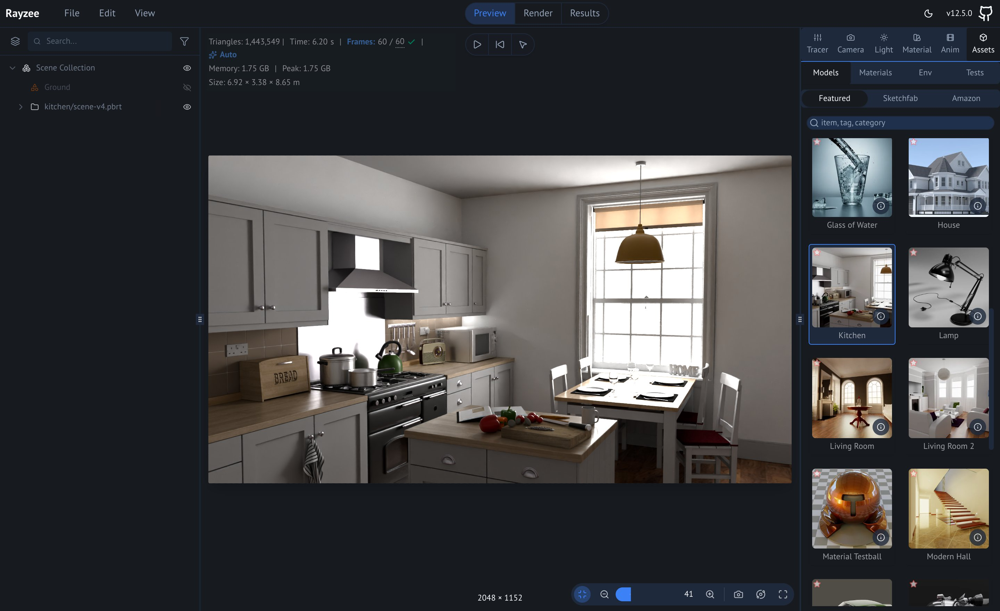

# Rayzee

**Photoreal rendering in the browser, in real time.**

Rayzee is a path tracer: it follows rays of light as they bounce around a 3D scene, on your graphics card, through
WebGPU. Glass, shadows, reflections and light coming in through a window all look the way they would in a photograph.
The picture starts grainy and sharpens while the view is still, and an AI denoiser cleans it as you go.

It comes in two forms: a **web app** you open and use, and the **engine** it is built on, an npm package for your own
pages and tools.



<div class="doors">
<div class="door">

## Rayzee app

For rendering your own models: open the app, drop in a glTF, USD, FBX, OBJ or pbrt scene, light it, and save a picture
or a video. Nothing to install.

- **[Open the app](https://atul-mourya.github.io/rayzee-renderer/)**
- [Getting around](app/): the layout and the Preview, Render and Results tabs
- [Opening models and skies](app/loading.md)
- [Final renders and export](app/render-and-export.md)
- [Troubleshooting](app/troubleshooting.md)

</div>
<div class="door">

## Rayzee engine

For developers: put the path tracer in your own web page or app, or render with no screen in Node. Built on
three.js; works with any framework.

```bash
npm install rayzee three
```

- [Getting started](guide/getting-started.md): set-ups, asset URLs, the viewer and the renderer core
- [Scenes](guide/scenes.md) and [Rendering](guide/rendering.md)
- [Headless rendering and Node](guide/headless.md)
- [API](guide/api.md): events, issues and every export

</div>
</div>

## How it works

The engine's design notes, for contributors and the curious: [the core and its add-ons](design/CORE_AND_ADDONS.md),
[the render pipeline](design/PIPELINE_ARCHITECTURE.md), [the path tracer's data](design/PATH_TRACER_SHADER_ARCHITECTURE.md),
[shading](design/SHADING.md) and more, in the sidebar. [Wavefront vs megakernel](articles/wavefront-vs-megakernel.md)
explains, in plain English, how the path tracer splits its work on the graphics card.

The code is on [GitHub](https://github.com/atul-mourya/rayzee-renderer), under the MIT licence.
