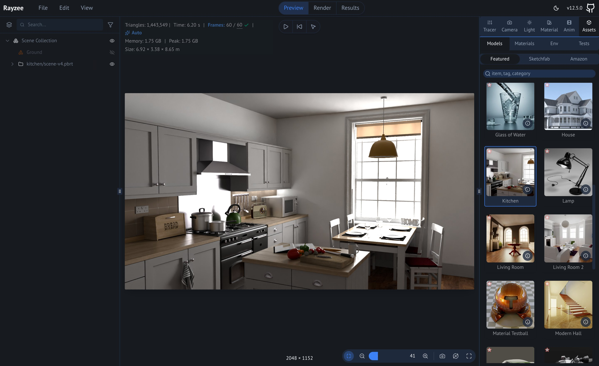

# Getting around

The Rayzee app renders 3D models with real light, in your browser. Open it at
[atul-mourya.github.io/rayzee-renderer](https://atul-mourya.github.io/rayzee-renderer/). There is nothing to install,
but it needs a browser with WebGPU: see [Troubleshooting](troubleshooting.md#the-app-does-not-start).

The app opens on a sample scene, a coffee maker. Drop your own model onto the view to replace it.

## The layout

| Area | What it holds |
|---|---|
| **Top bar** | The **File**, **Add**, **View** and **Help** menus; the **Preview**, **Render** and **Results** switch in the middle; on the right, the theme: **Light**, **Dark** or **Same as System**. |
| **Left panel** | The **Outliner**: every object, light and camera in the scene. On the Results page, your saved renders. |
| **The view** | The picture, with a few controls floating over it. |
| **Right panel** | Settings, in tabs. Which tabs you see depends on the top-bar tab. |

Drag the borders between the panels to resize them.

## Preview, Render and Results

The three tabs in the middle of the top bar are three stages of work:

- **Preview** is where you set the scene up. The picture renders fast and cleans up while the camera is still. The right
  panel has six tabs: **Tracer**, **Camera**, **Light**, **Material**, **Anim** and **Assets**.
- **Render** renders the finished picture at full quality, with the camera locked. See
  [Final renders and export](render-and-export.md).
- **Results** shows the renders you saved, to compare, adjust, edit with AI and export. See
  [Results and AI edits](results.md).

## The menus

**File**

| Item | What it does |
|---|---|
| **Open…** | Opens a model, an archive, a sky (`.hdr`, `.exr`) or a `.rayzee` project. Select several files to open a model made of several files. |
| **Open Folder…** | Opens a folder that holds a model and its textures. |
| **Open from URL…** | Opens a model or archive from a link. |
| **Open Recent…** | Reopens a scene you worked on, with its edits. |
| **Save Project…** | Saves the scene as a `.rayzee` project file; **Open…** opens it again. |
| **Export Picture…**, **Export Video…** | Saves the render as a picture, or the animation as a video. |
| **Export Saved Renders…**, **Import Saved Renders…** | Moves all your saved renders to or from a zip file. |
| **Storage…** | Shows what the app keeps on this device, and clears it. |

How each of these works: [Opening models and skies](loading.md) and [Projects and storage](projects.md).

**Add** puts a **Directional Light**, **Point Light**, **Spot Light** or **Area Light** into the scene and opens the
**Light** tab to set it up, or a **Cloud** or **Smoke** where the camera looks: see
[Smoke, clouds and fire](scene.md#smoke-clouds-and-fire). It is greyed out on the Results page.

**View** has **Reset Camera** (also <kbd>R</kbd>) and **Enter Full Screen**, which fills the screen with the whole app
(the toolbar's **Fullscreen** fills it with the picture alone).

**Help** opens these pages in a new tab: **User Guide** (this page), **Keyboard and Mouse**, **Troubleshooting** and
the **Developer Guide** for building on the engine. **Source Code** is the project on GitHub, **Release Notes** lists
what changed in each version, and **Report a Problem** opens a bug report with your version filled in. The version
you are running is at the bottom.

## Over the view

**Top left: the stats.** **Triangles:** the size of the scene. **Time:** and **Frames:** how long it has rendered and
how many samples it has; click either to choose which one stops the render, and click its limit to change it. **Auto**
stops early once the picture is clean (adaptive sampling). **Memory:** and **Peak:** are graphics memory, and **Size:**
is the model's size as its file gives it.

**Bottom left: the graphs.** **FPS**, **CPU**, **GPU** and **CPT** (GPU compute) timings. A **DN** graph joins them
while the AI denoiser is cleaning the live view.

**Top centre: the render controls.** **Pause** / **Play**, **Restart**, and **Click to Select** (Preview only), which
lets you pick objects by clicking them. Messages such as **Compiling shaders...**, **Denoising...** and
**Upscaling...** show just below.

**Bottom centre** shows the picture's size in pixels.

**Bottom right: the toolbar.**

| Button | What it does |
|---|---|
| **Translate**, **Rotate**, **Scale** | With an object selected: which handle it shows, to move, turn or resize it. |
| **World Space** / **Local Space** | Whether the handle follows the world's axes or the object's own. |
| **Auto-fit** | Fits the picture to the view. |
| **Zoom Out**, the zoom slider, **Zoom In** | Shows the picture smaller or larger (5–300 %). This does not change the render. |
| **Export Picture** | Opens the export window for the current render. |
| **Reset Camera** | Puts the camera back where it started (also <kbd>R</kbd>). |
| **Fullscreen** | Fills the screen with the view. |

## The Outliner

The left panel lists the scene as a tree, under **Scene Collection**.

- Click a row to select that object; click it again to deselect.
- The eye on each row hides or shows the object.
- **Remove from scene** (the bin, on hover) removes a model you loaded.
- Right-click a row for the same menu as right-clicking the view.
- **Search...** finds objects by name. The filter button chooses what to list: **Groups**, **Meshes**, **Lights**,
  **Cameras**.

Next: [Opening models and skies](loading.md), or the [keyboard and mouse controls](controls.md).
